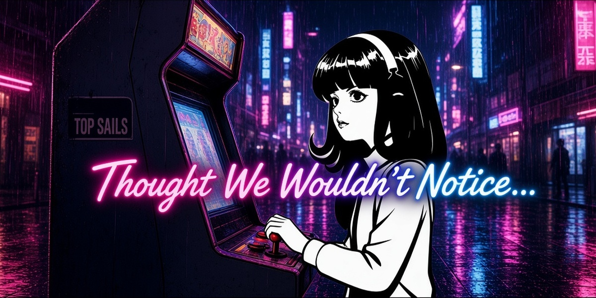

<p align="center">
  
</p>

<h1 align="center">Thought We Wouldn't Notice...</h1>

<p align="center">
  Insert a quarter, get a tiny original space-bug shooter,<br>
  and a wry "thought we wouldn't notice" line.
</p>

Version 0.1.7. A short Hermes Agent plugin: if a chat message is only a quarter, Hermes does not ask the model what to do with it. Hermes Desktop opens Top Sails over the window. The web dashboard grows the same cabinet if that page is open.

The in-game title is **Top Sails**. Bugs, ship, and tones are original geometry and oscillators drawn for this plugin. The dashboard tab explains the joke and has a Play Top Sails button, so you can start a game without sending a quarter first. The hero on that page is `assets/banner.jpg` (16:9). The catalog cover is `assets/catalog.jpg` (2:1).

## Install

From the public git URL:

```bash
hermes plugins install https://github.com/noblebrown-69/hermes-thought-we-wouldnt-notice --enable
```

From a local checkout:

```bash
mkdir -p ~/.hermes/plugins
rm -rf ~/.hermes/plugins/thought-we-wouldnt-notice
cp -a . ~/.hermes/plugins/thought-we-wouldnt-notice
hermes plugins enable thought-we-wouldnt-notice
```

Restart `hermes dashboard` (or `hermes serve`) so plugin discovery loads the hook and the cabinet tab. The plugin has no Python packages of its own (`python_dependencies: []`). It does not care which OS you are on (`platforms: []`).

Check that it loaded:

```bash
hermes thought-we-wouldnt-notice status
```

## Trigger

The whole message has to be the quarter. Case does not matter. Surrounding space, one layer of quotes or brackets, and trailing punctuation are ignored. These match:

- `25c`
- `25cents`
- `25 cents`
- `$.25`
- `$0.25`
- `0.25`
- `quarter`, `a quarter`, `one quarter`, `insert quarter`, `insert a quarter`

These do not:

- `that's $0.25 per call`
- `25 cents more RAM`
- `please insert 25c`
- `a quarter past three`

On a match, `pre_llm_call` returns a block. Hermes skips the model and shows this reply:

> Thought we wouldn't notice. But we did.

The same moment is written to the plugin data directory and broadcast as `plugin.thought-we-wouldnt-notice.coin`. Hermes Desktop opens Top Sails over the window without the web dashboard. The dashboard overlay still polls and pops the cabinet when that page is open. A quarter from the last 20 seconds still opens the cabinet if Desktop or the dashboard was refreshing.

`/quarter` does the same drop from any chat that runs plugin slash commands. It never reaches the model.

## Play

Dashboard tab: **Thought We Wouldn't Notice** (`/thought-we-wouldnt-notice`).

The tab is the about page and the game together. The hero is `assets/banner.jpg`. The copy tells you to drop a quarter in chat, and **Play Top Sails** starts a credit on the cabinet sitting on that same page.

The quarter popup is the overlay on top of whatever page you were on. Esc or BACK puts it away. The in-game marquee reads TOP SAILS. Attract text is `INSERT QUARTER` and `THOUGHT WE WOULDN'T NOTICE`.

| Control | Action |
| --- | --- |
| Left / Right, or A / D | Move |
| Up / Down, or W / S | Move inside the bottom lane |
| Space, click, tap, or FIRE | Shoot. Also starts a credit from the attract screen |
| M | Mute |
| Esc, Close, or BACK | Dismiss the cabinet and return to the chat |

Three waves of geometric bugs, three lives, then a win screen. Getting hit with no lives left is game over. Insert another quarter to run it again. The high score is kept in memory for the page and, under Hermes, in the plugin data file.

## Try it in Hermes Desktop

Leave the web dashboard closed.

1. Install and enable the plugin, then restart the gateway Desktop is attached to.
2. In Capabilities → Plugins, turn on **Thought We Wouldn't Notice** if it is still off, then Rescan so `desktop/plugin.js` is copied in.
3. Focus a chat and send `25c` as the whole message.
4. The reply is `Thought we wouldn't notice. But we did.` Top Sails opens over the Desktop window (a dialog when this Desktop build has one, otherwise a workspace tab, otherwise a pane on the right).
5. Press Esc. The cabinet closes immediately and the composer takes focus again. Close does the same.

The dashboard tab and its **Play Top Sails** button are unchanged when you do open the dashboard.

## Preview without Hermes

The cabinet bundle does not need a build step or a network fetch. From this repo:

```bash
python3 -m http.server 47221
```

Open `http://127.0.0.1:47221/preview/`. That page is the same `dashboard/dist` files the dashboard loads. It will not see chat messages. Use it to poke the game. The quarter trigger needs a running Hermes with this plugin enabled.

## Tests

From the plugin root:

```bash
python3 -m pytest
```

`pytest.ini` keeps collection inside `tests/`. Do not run pytest against the package directory itself, or it will try to import `__init__.py` as a test module.

## Layout

```
plugin.yaml                 manifest
__init__.py                 pre_llm_call, /quarter, hermes thought-we-wouldnt-notice
quarter.py                  whole-message matcher
cabinet_state.py            quarter ledger and high score
assets/banner.jpg           16:9 dashboard hero, served at GET /banner
assets/catalog.jpg          2:1 catalog cover (1200×600)
dashboard/manifest.json     tab, overlay slot, API
dashboard/plugin_api.py     GET /drops, POST /score, GET /banner, GET /cabinet
dashboard/dist/index.js     about page, play button, cabinet
desktop/plugin.js           pops Top Sails over Hermes Desktop; Esc closes it
dashboard/dist/style.css
preview/index.html          same page, outside Hermes
DEMO.md                     short recording script
```

CLI: `hermes thought-we-wouldnt-notice status`. There is no shorter alias. Slash command: `/quarter`.

## Original work

Top Sails is a fixed shooter written for this plugin: rectangles, ellipses, and short oscillator beeps. The playfield art is original. `assets/banner.jpg` is the 16:9 Neo Tokyo hero; `assets/catalog.jpg` is the 2:1 catalog cover. Attract text is `INSERT QUARTER` and `THOUGHT WE WOULDN'T NOTICE`.

## Hermes limits

- Swallowing the turn depends on `pre_llm_call` honoring `{"action": "block", "message": "..."}`. That is the documented policy result: no inference call, the withheld prompt is what later turns replay, and the user still sees what they typed plus this reply. This plugin does not patch Hermes internals.
- The web dashboard SDK has no `navigate()` call. The desktop SDK does (`host.navigate`), but this game is the web dashboard view. The popup is the documented `overlay` slot, which draws above the current page. The tab is there if the slot is not painted.
- There is no hook that focuses a browser tab. The cabinet learns about a quarter because the hook appends a drop under the profile plugin-data directory (`plugins.plugin_storage.plugin_data_dir` when Hermes provides it) and the overlay polls `GET /api/plugins/thought-we-wouldnt-notice/drops`. Expect about a second of delay. A dashboard that has not discovered plugins will not run the hook, so the message will not be swallowed and the popup will not open. Current Hermes discovers plugins before dashboard and serve startup. Restart after enable.
- `plugin_api.py` imports FastAPI because the dashboard process already has it. It is not listed under `python_dependencies`, and the agent-side hook does not import it.
- Plugin data survives `hermes plugins update`. Do not look for the score inside the install tree.
